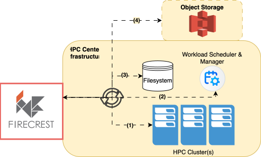

# Health checks

Internally, FirecREST performs a periodic **health check** of all underlying services that needs to work correctly.

These periodic tests not only provide the users with updated information about the current status of the HPC Center infra, but help FirecREST to run faster and more efficiently.



As you can see in the figure above, when enabled the periodic health check will update the status of

1. HPC cluster connectivity (via SSH)
2. Workload manager and scheduler (via SSH or API calls, depending the service)
3. Filesystem availability (read only)
4. Object storage availability (S3 interface is reachable or not)
5. Scheduler nodes (optional; the result can be used as a cache for the nodes endpoint)

## Probing configuration

Health check execution is configured through the `probing` section of the cluster configuration. The supported options are described below.

!!! example "Complete `probing` section in cluster configuration."
    ```yaml
  probing:
    interval_check: 120
    services:
      ssh:
        timeout: 10
      scheduler:
        timeout: 20
      filesystem:
        timeout: 10
    ```

Each service listed under the `services` subsection enables its corresponding health check. Omitting a service disables that specific check. It is allowed to specify a custom timeout, in seconds, for each service: the default is 10 seconds. If a check exceeds its configured timeout, it is considered failed. Health checks run their scheduler and SSH commands with this timeout instead of `ssh.timeout.command_execution` and `scheduler.timeout`, so a check can be given more time than regular user requests. For checks that use SSH, the timeout must be lower than `ssh.timeout.idle_timeout` minus `ssh.timeout.process_setup`. If the entire `services` section is omitted, all health checks for the specific cluster are disabled.

The `interval_check` field defines how often, in seconds, the health checks are executed for the cluster. If not specified, the default interval is 120 seconds. For backward compatibility the `interval` field is still accepted and behaves identically to`interval_check`, however it is deprecated and it should be replaced with the new field.

Note: the `probing` section is mandatory in the configuration, even if empty.

### Cached nodes information

The `nodes` service fetches the list of nodes from the scheduler at every health check, using the cluster service account. When `use_as_cache` is set to `true`, the `/status/{system_name}/nodes` endpoint returns the nodes fetched by the last successful check instead of querying the scheduler on each request. This reduces the load on the scheduler, at the cost of returning data up to `interval_check` seconds old.

!!! example "Serve the nodes endpoint from the health check data"
    ```yaml
  probing:
    interval_check: 60
    services:
      nodes:
        timeout: 20
        use_as_cache: true
    ```

Responses served from the cache include a `cachedAt` timestamp with the time the nodes were fetched by the health check:

```json
{
    "nodes": [ ... ],
    "cachedAt": "2026-01-02T03:04:05.123456Z"
}
```

If the check has not run yet, or its last execution failed, the endpoint falls back to querying the scheduler directly, as the calling user, and `cachedAt` is `null`. A non-null `cachedAt` therefore means the node list is what the cluster service account saw at that time, not the result of a query made as the caller.

!!! warning "Node visibility"
    Cached responses are shared by all users and reflect the service account's view of the nodes. If the scheduler limits node information per user (for example Slurm's `PrivateData=nodes`), enabling `use_as_cache` exposes the service account's view to every user: keep it disabled on those clusters.
 `use_as_cache` is only supported by the `nodes` service. The node list itself is not included in the `servicesHealth` report of `/status/systems`.

## Status reports

When consulting the API endpoint `/status/systems` you can see the status of health checks on the response JSON. The filed `servicesHealth` is composed of a list of `serviceTypes` as listed above.

The common format includes:

- `serviceType`: can be (1) `ssh`, (2) `scheduler`, (3) `filesystem`, (4) `s3`, and (5) `nodes`.
- `lastChecked`: timestamp of the last time the periodic test was performed
- `latency`: is used to establish if the service is healthy or not (depends on the configuration of FirecREST)
- `healthy`: `true` or `false`
- `message`: in case of error, it describes why the probe failed

??? example "Health check response for `serviceType: ssh`"
    ```json
    {
        "systems":[
            {
                "name": "system01",
                (...)
                "servicesHealth": [
                    (...)
                    {
                        "serviceType":"ssh",
                        "lastChecked":"2025-04-02T07:48:48.367139Z",
                        "latency":0.4212830066680908,
                        "healthy":true,
                        "message":null
                    },
                    (...)
                ]
            },
            {
                "name": "system02",
                (...)
                {
                    "serviceType": "ssh",
                    "lastChecked": "2025-04-02T07:48:49.082887Z",
                    "latency": 1.1373629570007324,
                    "healthy": false,
                    "message": "Too many authentication failures"
                },
            }
        ]
    }
    ```

??? example "Health check response for `serviceType: scheduler`"
    ```json
    {
        "systems":[
            {
                "name": "system01",
                (...)
                "servicesHealth": [
                    {
                        "serviceType":"scheduler",
                        "lastChecked":"2025-04-01T00:01:00.000000Z",
                        "latency":1.1002883911132812,
                        "healthy":true,
                        "message":null,
                        "nodes": {
                            "available":130,
                            "total":143
                        }
                    },
                ]
            },
            {
                "name": "system02",
                (...)
                "servicesHealth": [
                    {
                        {
                            "serviceType":"scheduler",
                            "lastChecked":"2025-04-01T00:01:00.000000Z",
                            "latency":0.02857375144958496,
                            "healthy":false,
                            "message":"ClientConnectorError: Cannot connect to host",
                            "nodes":null
                        }
                    }
                ]
            }
        ]
    }
    ```

??? example "Health check response for `serviceType: filesystem`"
    ```json
    {
        "systems":[
            {
                "name": "system01",
                (...)
                "servicesHealth": [
                    {
                        "serviceType":"filesystem",
                        "lastChecked":"2025-04-01T00:01:00.000000Z",
                        "latency":1.3535213470458984,
                        "healthy":true,
                        "message":null,
                        "path":"/path/to/filesystem01"
                    },
                    {
                        "serviceType": "filesystem",
                        "lastChecked":"2025-04-01T00:01:00.000000Z",
                        "latency":0.9655811786651611,
                        "healthy":false,
                        "message":"Too many authentication failures",
                        "path":"/path/to/filesystem02"
                    }
                ]
            }
        ]
    }
    ```

??? example "Health check response for `serviceType: s3`"
    ```json
    {
        "systems":[
            {
                "name": "system01",
                (...)
                "servicesHealth": [
                    {
                        "serviceType": "s3",
                        "lastChecked":"2025-04-01T00:01:00.000000Z",
                        "latency": 0.22784161567687988,
                        "healthy": true,
                        "message": null
                    }
                ]
            }
        ]
    }
    ```

## Improving command execution

Health checks not only provide information about the status of the underlying infrastructure of the HPC center; they enable FirecREST to predict that the command executed in the cluster has a very high probability of being executed as expected.

When enabled, FirecREST will prevent execute commands on unhealthy services

!!! example "API call to an unhealthy endpoint"
    ```bash
    $ curl filesystem/system02/ops/ls?path=/path/to/filesystem02
    {
        "errorType": "error",
        "message": "The ssh service for the requested system (system02) is unhealthy.",
        "data": null,
        "user": "firecr01"
    }
    ```

